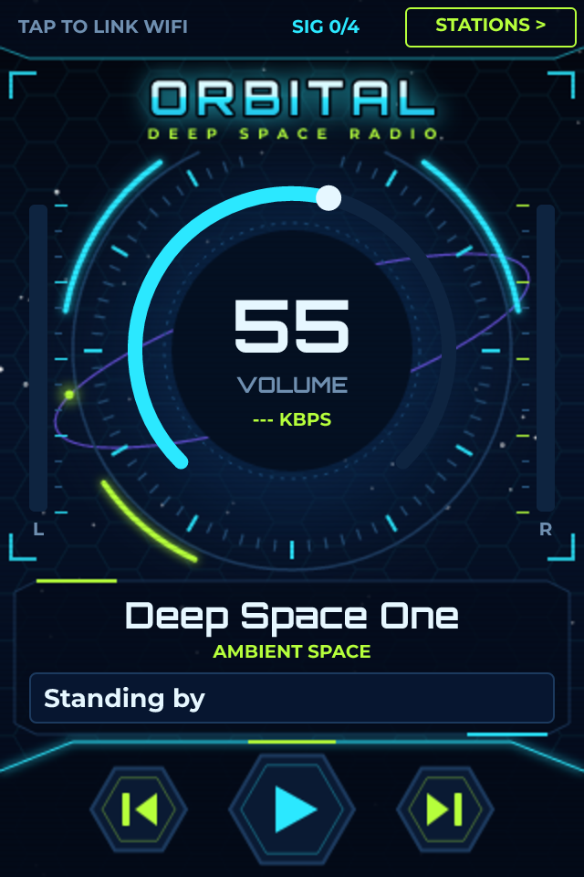
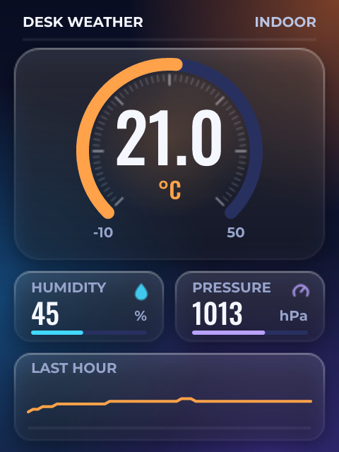
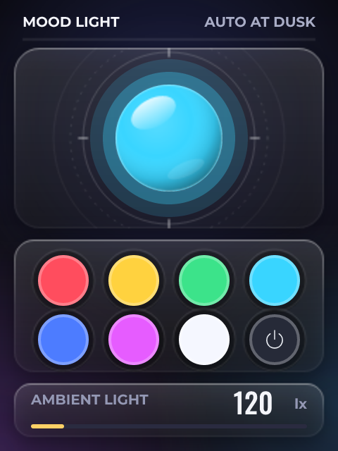
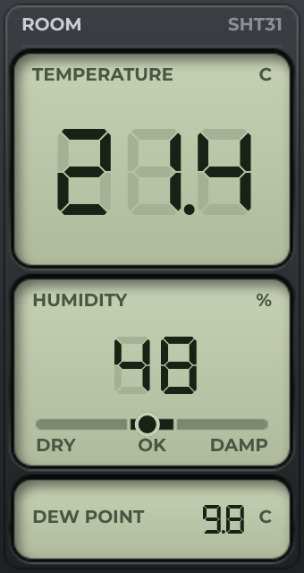
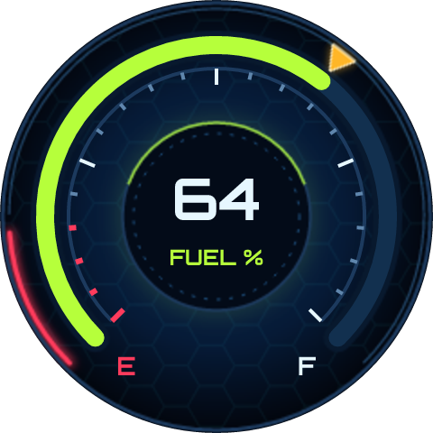

# LCD Wizard examples

18 LVGL designs for ESP32 display boards, made in [LCD Wizard](https://lcdwizard.com). Each folder holds the design as `design.json`, a picture of every screen, and the artwork where it has any. Open one in the designer with **File > Open project file**, change it, and export a project that builds for the board: Arduino or PlatformIO, MicroPython, or ESPHome, depending on the design.

| | Example | Board | Builds with | Screens |
|---|---|---|---|---|
|  | [**NEON DECK**](examples/neon-deck) An internet radio with real VU meters, a station list and WiFi setup on the panel. | [LCDWIKI 2.8" ESP32-32E (E32R28T)](https://lcdwizard.com/boards/lcdwiki-e32r28t) | Arduino (C++) | 4 |
|  | [**ORBITAL**](examples/orbital) A deep-space internet radio with a HUD volume dial, live bitrate and VU meters, for a 3.5" ESP32-S3 with a proper audio codec. | [LCDWIKI 3.5" ESP32-S3 (ES3C35P)](https://lcdwizard.com/boards/lcdwiki-es3c35p) | Arduino (C++) | 4 |
|  | [**Hello CYD**](examples/hello-cyd) A dial, a readout and a button. Nothing to wire - press Play and drag something. | [ESP32-2432S028R "Cheap Yellow Display"](https://lcdwizard.com/boards/cyd-2432s028r) | Arduino (C++) | 1 |
|  | [**Desk Weather**](examples/cyd-weather) BME280 on the CN1 connector: temperature, humidity, pressure and a rolling chart. | [ESP32-2432S028R "Cheap Yellow Display"](https://lcdwizard.com/boards/cyd-2432s028r) | Arduino (C++) | 1 |
|  | [**Air Quality**](examples/cyd-air) SCD40 CO2 plus a BH1750 light sensor, with a verdict that changes colour. | [ESP32-2432S028R "Cheap Yellow Display"](https://lcdwizard.com/boards/cyd-2432s028r) | Arduino (C++) | 1 |
|  | [**Mood Light**](examples/cyd-mood) Drive the CYD's onboard RGB LED from the touchscreen, and let it turn itself on at dusk. | [ESP32-2432S028R "Cheap Yellow Display"](https://lcdwizard.com/boards/cyd-2432s028r) | Arduino (C++) | 1 |
|  | [**Bench Supply Meter**](examples/bench-meter) Volts, amps and watts from an INA219, with a current limit you set on the panel. | [ESP32 + ILI9341 2.8" SPI](https://lcdwizard.com/boards/esp32-ili9341-spi) | ESPHome | 2 |
|  | [**Heating Thermostat**](examples/thermostat) A room thermostat with a dial, hysteresis, and a boost that expires by itself. | [ESP32-2432S028C (capacitive CYD)](https://lcdwizard.com/boards/cyd-2432s028c) | ESPHome | 2 |
|  | [**Lighting Wall Panel**](examples/wall-panel) Four rooms, a dimmer and an all-off, published to Home Assistant as entities. | [WT32-SC01](https://lcdwizard.com/boards/wt32-sc01) | ESPHome | 1 |
|  | [**Pocket Hygrometer**](examples/pocket-meter) Temperature, humidity and dew point on a 170 x 320 strip. | [LilyGO T-Display-S3](https://lcdwizard.com/boards/lilygo-tdisplay-s3) | ESPHome | 1 |
|  | [**Greenhouse Watering**](examples/greenhouse) Soil moisture on the ADC, a pump on a relay, and a lockout so it cannot flood the bench. | [ESP32-S3 + ILI9341 SPI](https://lcdwizard.com/boards/s3-ili9341-spi) | MicroPython | 2 |
|  | [**Espresso Shot Timer**](examples/shot-timer) A big readable number, a target band, and the last shot to compare against. | [M5Stack Core2](https://lcdwizard.com/boards/m5stack-core2) | MicroPython | 1 |
|  | [**Round Volume Knob**](examples/round-knob) A machined knob on a 240 x 240 round panel: turn the dimple, press the middle to mute. | [ESP32-S3 + GC9A01 1.28" round](https://lcdwizard.com/boards/s3-gc9a01-round) | MicroPython | 1 |
|  | [**Coolant Gauge**](examples/obd-coolant-gauge) Engine temperature on a round panel, read from the car over CAN: a real needle on a real scale. | [ESP32-S3 + GC9A01 1.28" round](https://lcdwizard.com/boards/s3-gc9a01-round) | Arduino (C++) | 1 |
|  | [**Fuel Gauge**](examples/obd-fuel-gauge) Fuel level on a round panel, read from the car over CAN: an arc that fills and a pointer that rides it. | [ESP32-S3 + GC9A01 1.28" round](https://lcdwizard.com/boards/s3-gc9a01-round) | Arduino (C++) | 1 |
|  | [**Reflow Oven Controller**](examples/reflow-oven) A lead-free profile, a thermocouple on SPI, and a chart of what the oven actually did. | [STM32F407 + ILI9341 SPI](https://lcdwizard.com/boards/stm32f407-ili9341) | Arduino (C++) | 1 |
|  | [**Dust Extraction Panel**](examples/dust-extraction) Four blast gates on an I2C expander, an extractor that follows them, and a filter that says when it is blocked. | [Sunton ESP32-8048S043 (4.3" RGB)](https://lcdwizard.com/boards/sunton-8048s043) | Arduino (C++) | 1 |
|  | [**Solar Dashboard**](examples/solar-dashboard) Array, house, battery and net power, with a day of history on one chart. | [Sunton ESP32-8048S070 (7" RGB)](https://lcdwizard.com/boards/sunton-8048s070) | Arduino (C++) | 1 |

## Using a design

1. Open the designer at https://app.lcdwizard.com/app. It runs in the browser and needs no account to design or open a file.
2. **File > Open project file**, and pick an example's `design.json`.
3. Press **Play** to try it with simulated readings, or **Export code** for the project.

The same designs are in the [gallery](https://lcdwizard.com/gallery), where **Open a copy** does the same in one click.

## Contributing

Made something with LCD Wizard? Publish it to the gallery from the designer, or open a pull request here with its `design.json` and a screenshot.

## Licence

© 2026 Jonathan Harrocks (LCD Wizard). [MIT](LICENSE): use the designs, and anything you build from them, for anything. Fonts and icons the designs use carry their own licences (SIL OFL 1.1 and the Unlicense), noted inside each export.

