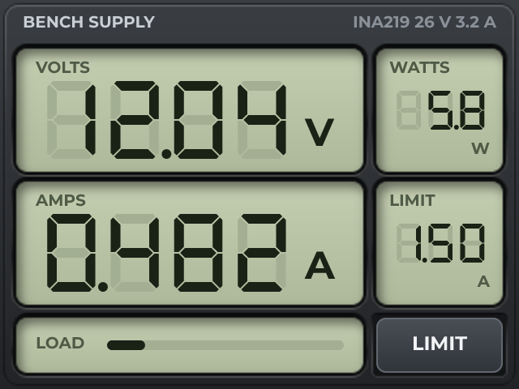
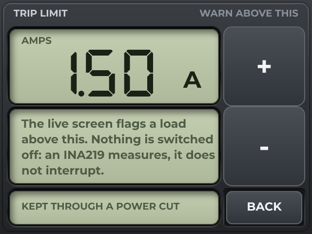

# Bench Supply Meter

*Volts, amps and watts from an INA219, with a current limit you set on the panel.*

A bench supply with no display, given one that reads better than most.

An INA219 sits across the output and reports voltage, current and power over I2C. It is drawn as the front of a bench instrument: windows in a panel, and digits over their own unlit segments. The second screen sets the current you want warning about, with + and - keys - a variable the spinbox writes and an automation reads. Both screens are laid out in the same windows of one picture, which is half the flash of a picture each.

Nothing is switched: an INA219 measures, it does not interrupt. The banner tells you, and what you do about it is yours.

Exports as ESPHome, so there is no compiler to install - one command flashes it.

## Hardware and build

- **Board:** [ESP32 + ILI9341 2.8" SPI](https://lcdwizard.com/boards/esp32-ili9341-spi)
- **MCU:** ESP32 (WROOM / WROVER)
- **Display:** ILI9341 240 x 320, XPT2046 touch
- **Graphics library:** TFT_eSPI
- **LVGL:** 9
- **Exports to:** ESPHome
- **Peripherals:** INA219 (current)
- **Libraries:** lvgl, TFT_eSPI, Adafruit INA219
- **Screens:** 2

## Open it

1. Open the designer: https://app.lcdwizard.com/app (nothing to install, no account needed).
2. **File > Open project file** and choose `design.json` from this folder.
3. Change what you like, then **Export code** for a project that builds for the board.

Or open a copy straight from the gallery: https://lcdwizard.com/p/bench-meter

## Screens

### Live

### Limits

## Artwork

The images this design uses, as the original files. They are also inside `design.json`, so the design opens without them.

- [`assets/panel-bench.png`](assets/panel-bench.png) - 320 x 240
