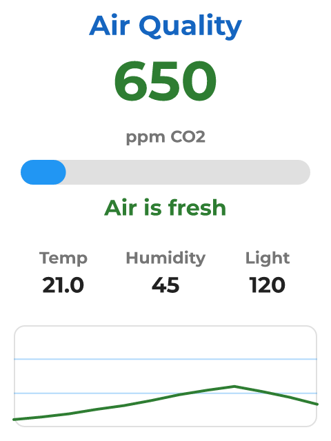

# Air Quality

*SCD40 CO2 plus a BH1750 light sensor, with a verdict that changes colour.*

What the air in the room is actually doing.

An SCD40 measures CO2, temperature and humidity, and a BH1750 measures illuminance. Both sit on the CYD's CN1 connector - one I2C bus, two addresses, four wires.

Two automations watch the CO2 reading: past 1000 ppm the verdict turns red and asks you to open a window, and back under 800 it goes green again. The gap between the two thresholds is deliberate, so a reading hovering on the line does not flicker.

The SCD40 only produces a new sample every five seconds or so, which is why it is polled at that rate rather than faster.

## Hardware and build

- **Board:** [ESP32-2432S028R "Cheap Yellow Display"](https://lcdwizard.com/boards/cyd-2432s028r)
- **MCU:** ESP32 (WROOM / WROVER)
- **Display:** ILI9341 320 x 240, XPT2046 touch
- **Graphics library:** TFT_eSPI
- **LVGL:** 9
- **Exports to:** Arduino (C++)
- **Peripherals:** SCD40 / SCD41 (CO2), BH1750 (light)
- **Libraries:** lvgl, TFT_eSPI, SparkFun SCD4x Arduino Library, BH1750
- **Screens:** 1

## Open it

1. Open the designer: https://app.lcdwizard.com/app (nothing to install, no account needed).
2. **File > Open project file** and choose `design.json` from this folder.
3. Change what you like, then **Export code** for a project that builds for the board.

Or open a copy straight from the gallery: https://lcdwizard.com/p/cyd-air
