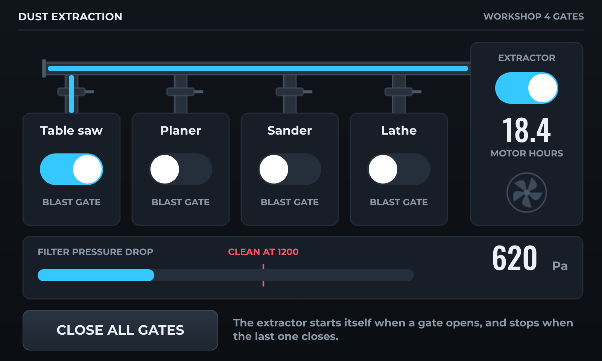

# Dust Extraction Panel

*Four blast gates on an I2C expander, an extractor that follows them, and a filter that says when it is blocked.*

An 800 x 480 panel by the workshop door, pressed with gloves on - so the targets are large and there is nothing small to hit.

The gates are on a PCF8574 rather than on the board, which is what you do when the panel is by the door and the gates are across the shop: one pair of wires instead of four runs. The extractor starts itself when any gate opens and stops when the last one closes, so nobody has to remember.

The screen is a mimic of the ducting. The ducts are a picture; the air in them is a strip of colour a drop, shown while that gate is open, so you can see from the door where the extractor is pulling from.

A differential pressure sensor across the filter drives the bar, and an analog threshold puts up the cleaning banner - which is a more honest service interval than hours run, because a filter blocks at the rate the work dirties it.

The motor hour meter is persisted, so it survives a power cut.

## Hardware and build

- **Board:** [Sunton ESP32-8048S043 (4.3" RGB)](https://lcdwizard.com/boards/sunton-8048s043)
- **MCU:** ESP32-S3
- **Display:** ST7262 800 x 480, GT911 touch
- **Graphics library:** GFX Library for Arduino
- **LVGL:** 9
- **Exports to:** Arduino (C++)
- **Peripherals:** PCF8574
- **Libraries:** lvgl, GFX Library for Arduino, PCF8574 library
- **Screens:** 1

## Open it

1. Open the designer: https://app.lcdwizard.com/app (nothing to install, no account needed).
2. **File > Open project file** and choose `design.json` from this folder.
3. Change what you like, then **Export code** for a project that builds for the board.

Or open a copy straight from the gallery: https://lcdwizard.com/p/dust-extraction

## Artwork

The images this design uses, as the original files. They are also inside `design.json`, so the design opens without them.

- [`assets/panel-dust.png`](assets/panel-dust.png) - 800 x 480
