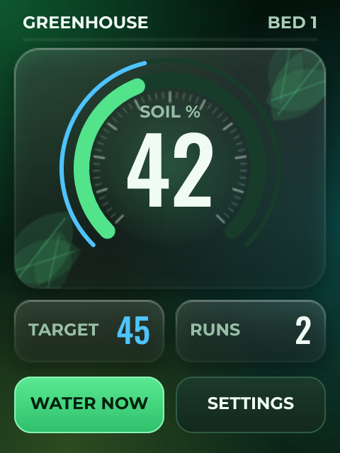
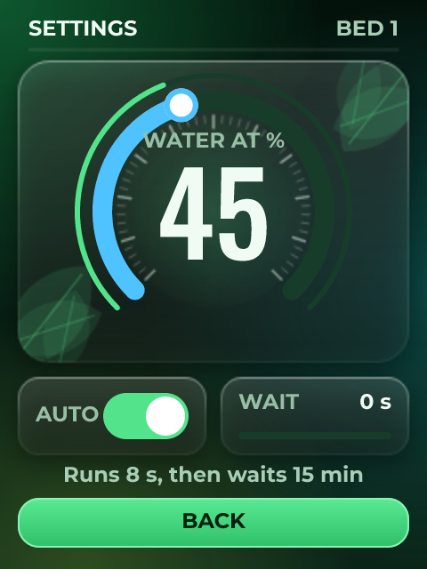

# Greenhouse Watering

*Soil moisture on the ADC, a pump on a relay, and a lockout so it cannot flood the bench.*

The interesting part of this one is not the watering, it is the refusing.

A capacitive probe reads high when dry, so the percentage is inverted and clamped. When the soil drops below the target the pump runs - for eight seconds, and then it waits fifteen minutes whatever the probe says. A sensor that has fallen out of the pot reads bone dry forever, and that limit is the difference between a watered plant and an empty reservoir on the floor.

Two rings share a centre: the wide one is the soil and the thin one the level it is watered at, so how far apart they are is how long until the pump runs. The settings screen swaps them, and the wide ring becomes the control.

No I2C parts at all: an analog input, a digital output and some arithmetic. That is the shape of design MicroPython suits, and you can change the watering time from the REPL between runs without rebuilding anything.

## Hardware and build

- **Board:** [ESP32-S3 + ILI9341 SPI](https://lcdwizard.com/boards/s3-ili9341-spi)
- **MCU:** ESP32-S3
- **Display:** ILI9341 240 x 320, XPT2046 touch
- **Graphics library:** LovyanGFX
- **LVGL:** 9
- **Exports to:** MicroPython
- **Libraries:** lvgl, LovyanGFX
- **Screens:** 2

## Open it

1. Open the designer: https://app.lcdwizard.com/app (nothing to install, no account needed).
2. **File > Open project file** and choose `design.json` from this folder.
3. Change what you like, then **Export code** for a project that builds for the board.

Or open a copy straight from the gallery: https://lcdwizard.com/p/greenhouse

## Screens

### Main

### Setup

## Artwork

The images this design uses, as the original files. They are also inside `design.json`, so the design opens without them.

- [`assets/panel-green.png`](assets/panel-green.png) - 240 x 320
