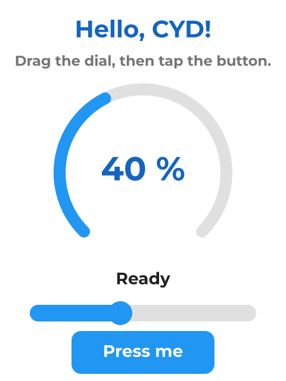

# Hello CYD

*A dial, a readout and a button. Nothing to wire - press Play and drag something.*

The starting point for a Cheap Yellow Display.

A slider drives the arc and the number above it through a widget-to-widget binding, and the button writes a new caption into the status label. No sensors, no wiring: this runs on a CYD straight out of the box.

Press Play in the designer to try it without flashing anything, then take it apart - change the range on the arc, restyle the button, add a screen.

## Hardware and build

- **Board:** [ESP32-2432S028R "Cheap Yellow Display"](https://lcdwizard.com/boards/cyd-2432s028r)
- **MCU:** ESP32 (WROOM / WROVER)
- **Display:** ILI9341 320 x 240, XPT2046 touch
- **Graphics library:** TFT_eSPI
- **LVGL:** 9
- **Exports to:** Arduino (C++)
- **Libraries:** lvgl, TFT_eSPI
- **Screens:** 1

## Open it

1. Open the designer: https://app.lcdwizard.com/app (nothing to install, no account needed).
2. **File > Open project file** and choose `design.json` from this folder.
3. Change what you like, then **Export code** for a project that builds for the board.

Or open a copy straight from the gallery: https://lcdwizard.com/p/hello-cyd
