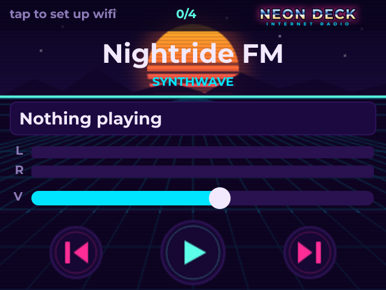
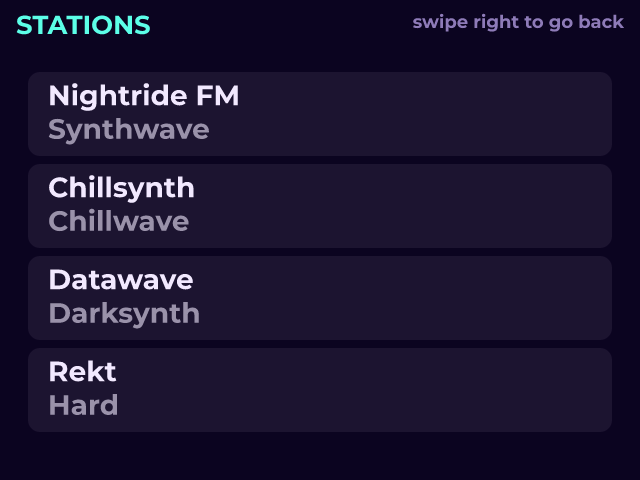
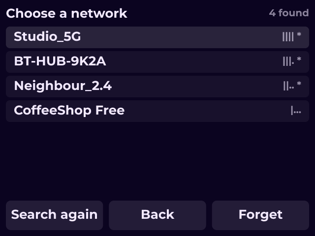
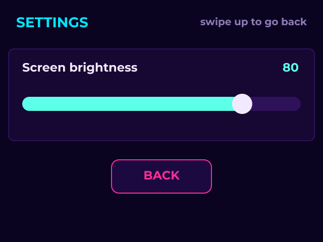

# NEON DECK

*An internet radio with real VU meters, a station list and WiFi setup on the panel.*

A synthwave internet radio for LCDWIKI's 2.8-inch ESP32-32E (E32R28T), a Cheap Yellow Display alternative, and a worked example of almost everything the designer can do: joining a network, keeping settings across a reboot, playing a stream, and binding widgets to hardware. Clone it and take it apart - most of the decisions below are visible in two clicks.

WHY THE AUDIO IS WHAT IT IS
The board decided this, not taste. The speaker connector sits behind an SC8002B amplifier fed by the chip's own DAC on GPIO 26, and the amplifier only plays while GPIO 4 is held low - the board preset does both. That is 8-bit and mono, which then settles two more things: the codec is MP3 rather than AAC, because the AAC decoder wants about 45 KB of working memory this board has not got, and the stations are 128 kbps because the ceiling is the DAC, not the stream.

On a Sunton CYD the same panel and touch sit on the same pins, but GPIO 4 is the red LED, so choose that board's preset instead and the amplifier needs no enabling.

There is a trap in that pin, and it is worth knowing before you build anything with sound on this board. The internal DAC is driven through I2S, and I2S maps its left channel to GPIO 26 and its right to GPIO 25 - and GPIO 25 is the touch controller's clock, on this board as on the Sunton CYD. The usual audio library turns on both channels. The export turns on one.

WHY THE METERS ARE BOUND TO THE PLAYER, NOT A VARIABLE
Open either meter and look at its binding: the source is the player itself, not a variable. A level is a reading - nothing computes with it - so making you declare a variable to show one would be ceremony. The volume slider is the same idea taken one step further: it is a two-way binding, so the slider IS the volume rather than a proxy for it. It sets the level, and follows it when something else does.

The levels are taken off the audio samples on their way out, so those bars move with the music rather than on a timer. Press Play in the designer and you will see them move there too - the preview synthesises its own music rather than fetching a station, and taps it with an analyser, so the meters are real in both places.

WHY THE TRACK TITLE SCROLLS
It is a Text variable bound to the stream metadata, and its label mode is Scroll circular rather than Wrap. An ICY title can be sixty characters and the box is 288 px wide; wrapping would push it out of its panel and clipping would hide the half that matters. Design for the long one - many stations send no title at all, so it also has to look right empty.

WHY THERE IS A BUTTON OVER THE STATUS BAR
The transparent button at the top left is the way to the network screen. There are swipes too - left for stations, up for the network - but a swipe announces itself to nobody, and on a first boot with no credentials the radio cannot play and there has to be something visible to press. It sits on the network state, because that is what somebody looks at when there is no network.

WHY THE PASSWORD IS NOWHERE IN THIS FILE
The whole join is one widget - scan, pick, type, verify - and the password is typed on the device at exactly one of those steps. The setting it goes into is marked secret, which means nothing can read it back, it is never written to the settings file, and it carries no value in the design. That last part is why cloning this is safe: a password typed into a project would travel with every copy of it.

The access point password is the exception, and it is in here in plain sight. An access point publishes the password people need in order to reach it, so there is no earlier moment at which somebody could have entered one. Change it before you flash this - and keep it to eight characters or more, because softAP() given a shorter one starts an open network and returns success.

WHAT SURVIVES A REBOOT
Four settings: the network, its password, the volume and the last station. They live in NVS, which is its own flash partition - so an ordinary firmware upload does not touch them, though "Erase All Flash" does. The volume writes itself shortly after you move the slider; that automatic save is right for a volume and wrong for a calibration, where the point is being able to abandon a bad one by not saving it.

WHY THE TRANSPORT IS ONE BUTTON AND NOT TWO
Play and Stop are the same control: an Image Button with the Checkable flag, which is what lets LVGL reach the checked state at all. Without that flag the checked artwork is compiled into the firmware and never drawn - a button that simply does not change. Four slots are filled: released, pressed, checked, checked pressed. An image button swaps pictures rather than tinting one, and on art that already glows that matters, because a pressed tint over a glow reads as a fault rather than a press.

An ordinary button whose caption an action rewrites also works, and leaves every path that stops playback having to remember to change it back. A checked state lives on the widget, so there is no second copy of it to drift.

THE LOOK, AND WHY THE BACKGROUND IS ONE IMAGE
RGB565 on a 2.8 inch panel rewards broad flat colour and hard-edged glow, and punishes fine gradients (they band) and 1 px detail (it disappears). Synthwave is almost a specification for those constraints, which is why this reads as clearly on glass as it does on screen.

The sun, the grid, the horizon and the two darker bands the text sits on are one full-screen asset, placed first so everything else is over it. As widgets that would be a dozen objects with their own styles; as an image it is a single blit. It is also composed around this layout rather than decorated behind it - the sun sits where the station name lands, the horizon where the content starts, the bands exactly where the track box and the transport are. A background drawn independently and dropped in underneath is how you get a beautiful picture with unreadable text on it.

The backdrop is RGB565 because nothing shows through it; the buttons on top are RGB565A8 because they need their alpha. Alpha costs a byte a pixel, so spending it on the one asset that cannot use it would be the largest single waste in the project.

The stations are real and long-running; swap them for your own on the Data tab, and prefer http where a station offers both - TLS wants about 40 KB of heap that the decoder would rather have.

## Hardware and build

- **Board:** [LCDWIKI 2.8" ESP32-32E (E32R28T)](https://lcdwizard.com/boards/lcdwiki-e32r28t)
- **MCU:** ESP32 (WROOM / WROVER)
- **Display:** ILI9342 / ILI9342C 320 x 240, XPT2046 touch
- **Graphics library:** TFT_eSPI
- **LVGL:** 9
- **Exports to:** Arduino (C++)
- **Libraries:** lvgl, ESP8266Audio, TFT_eSPI
- **Screens:** 4

## Open it

1. Open the designer: https://app.lcdwizard.com/app (nothing to install, no account needed).
2. **File > Open project file** and choose `design.json` from this folder.
3. Change what you like, then **Export code** for a project that builds for the board.

Or open a copy straight from the gallery: https://lcdwizard.com/p/neon-deck

## Screens

### Radio

### Stations

### Network

### Settings

## Artwork

The images this design uses, as the original files. They are also inside `design.json`, so the design opens without them.

- [`assets/radio-bg.png`](assets/radio-bg.png) - 320 x 240
- [`assets/wordmark.png`](assets/wordmark.png) - 260 x 44
- [`assets/btn-play.png`](assets/btn-play.png) - 56 x 56
- [`assets/btn-play-on.png`](assets/btn-play-on.png) - 56 x 56
- [`assets/btn-stop.png`](assets/btn-stop.png) - 56 x 56
- [`assets/btn-stop-on.png`](assets/btn-stop-on.png) - 56 x 56
- [`assets/btn-next.png`](assets/btn-next.png) - 46 x 46
- [`assets/btn-next-on.png`](assets/btn-next-on.png) - 46 x 46
- [`assets/btn-prev.png`](assets/btn-prev.png) - 46 x 46
- [`assets/btn-prev-on.png`](assets/btn-prev-on.png) - 46 x 46
