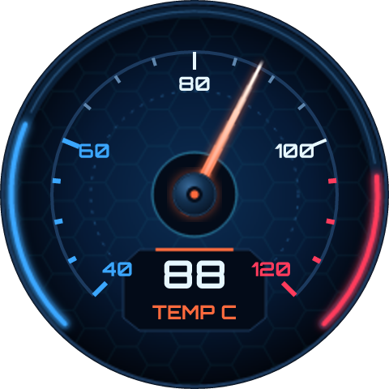

# Coolant Gauge

*Engine temperature on a round panel, read from the car over CAN: a real needle on a real scale.*

A coolant temperature gauge for a 240 x 240 round panel, fed from the diagnostic socket. The ESP32 has the CAN controller built in, so the only extra part is a transceiver.

The needle is a picture that a Scale turns about a pivot inside it, under a hub cap that is a second picture and does not turn - it is lit from one side, and a highlight that went round with the needle would give it away. The cold and hot ends are sections of the scale, so the red line is a setting: move it and the ticks and numbers under it change colour with it.

It reads PID 05, which every car with OBD-II over CAN reports. The device shows each value with its code, and takes signals of your own - another PID, or bytes of a frame the bus carries - for anything else the car has.

With no car attached it says NO ECU and the needle rests at cold.

## Hardware and build

- **Board:** [ESP32-S3 + GC9A01 1.28" round](https://lcdwizard.com/boards/s3-gc9a01-round)
- **MCU:** ESP32-S3
- **Display:** GC9A01 / GC9A01A 240 x 240, CST816S touch
- **Graphics library:** GFX Library for Arduino
- **LVGL:** 9
- **Exports to:** Arduino (C++)
- **Peripherals:** CAN bus / OBD-II (car diagnostics)
- **Libraries:** lvgl, GFX Library for Arduino
- **Screens:** 1

## Open it

1. Open the designer: https://app.lcdwizard.com/app (nothing to install, no account needed).
2. **File > Open project file** and choose `design.json` from this folder.
3. Change what you like, then **Export code** for a project that builds for the board.

Or open a copy straight from the gallery: https://lcdwizard.com/p/obd-coolant-gauge

## Artwork

The images this design uses, as the original files. They are also inside `design.json`, so the design opens without them.

- [`assets/gauge-temp-face.png`](assets/gauge-temp-face.png) - 240 x 240
- [`assets/gauge-needle.png`](assets/gauge-needle.png) - 112 x 18
- [`assets/gauge-cap.png`](assets/gauge-cap.png) - 34 x 34
