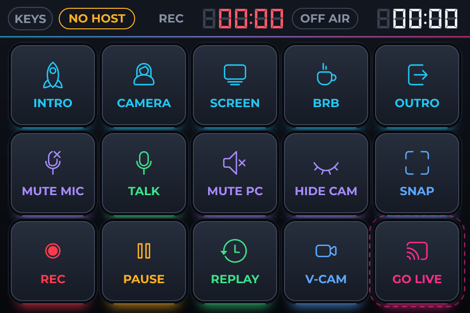
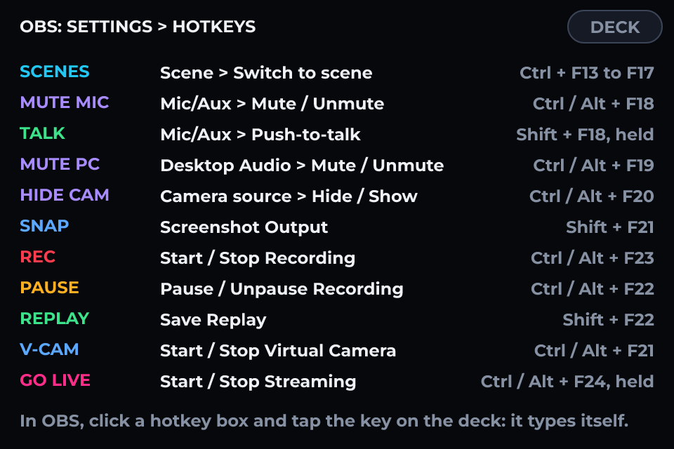

# OBS Stream Deck

*A Bluetooth stream deck for OBS Studio: fifteen keys, an ON AIR tally and two timers. It pairs as a keyboard, so nothing is installed.*

A stream deck for OBS Studio on a 3.5-inch ESP32-S3 touchscreen: five scenes, mute and push-to-talk, record, pause, replay, virtual camera and a guarded GO LIVE, under a tally bar with an ON AIR lamp and two timers. To the PC it is a Bluetooth keyboard, so there is no driver, no companion program and no cable. Pair it, tell OBS which key does what, and it works - in OBS or in anything else that takes a hotkey.

It is drawn for LCDWIKI's ES3C35P turned on its side, 480 x 320. Sending keys over Bluetooth is part of Pro; the design is free to open, restyle and press Play on.

SETTING OBS UP
1. Flash the board. On the PC, add a Bluetooth device and choose "OBS Deck". There is no number to type, and the bar on the deck changes from NO HOST to LINKED.
2. In OBS open Settings > Hotkeys. Click the box beside an action and tap its key on the deck: OBS writes the shortcut in for you. A key with two actions sends the second on its second tap - tap REC for the Start Recording box, click the Stop Recording box, tap REC again.
3. Or type them in from the list below. KEYS on the deck shows the same list on the panel.

THE HOTKEYS
Ctrl is on, Alt is off and Shift is a single press, on every key.
INTRO - Ctrl + F13 - Switch to scene, on your opening scene.
CAMERA - Ctrl + F14 - Switch to scene, on your camera scene.
SCREEN - Ctrl + F15 - Switch to scene, on your screen or game scene.
BRB - Ctrl + F16 - Switch to scene, on your "be right back" scene.
OUTRO - Ctrl + F17 - Switch to scene, on your closing scene.
MUTE MIC - Ctrl + F18 for Mic/Aux > Mute, Alt + F18 for Mic/Aux > Unmute.
TALK - Shift + F18, held for as long as the key is - Mic/Aux > Push-to-talk.
MUTE PC - Ctrl + F19 for Desktop Audio > Mute, Alt + F19 for Desktop Audio > Unmute.
HIDE CAM - Ctrl + F20 for Hide (your camera source), Alt + F20 for Show (your camera source).
SNAP - Shift + F21 - Screenshot Output.
REC - Ctrl + F23 for Start Recording, Alt + F23 for Stop Recording.
PAUSE - Ctrl + F22 for Pause Recording, Alt + F22 for Unpause Recording.
REPLAY - Shift + F22 - Save Replay.
V-CAM - Ctrl + F21 for Start Virtual Camera, Alt + F21 for Stop Virtual Camera.
GO LIVE - Ctrl + F24 for Start Streaming, Alt + F24 for Stop Streaming. Hold the key: a tap does nothing.

The scene keys are named for a common set. Bind them to whichever five scenes you use and change the captions and icons to suit; the keys they send stay the same. Push-to-talk also needs "Enable Push-to-talk" ticked for the microphone under Settings > Audio.

WHY THE KEYS ARE F13 TO F24, AND WHY EACH TAKES ONE MODIFIER
F13 to F24 are real keys that no keyboard has, so nothing else on the PC will ever send one and no program has claimed them. No key is used bare beside a modified one, and none takes two modifiers: a program that matches loosely takes Ctrl + Shift + F23 for a press of Ctrl + F23 as well, and a deck must never stop a recording by starting something else.

WHY START AND STOP ARE TWO HOTKEYS
A keyboard only talks one way: the deck cannot ask OBS whether it is recording. With one hotkey that toggles, a single click of the mouse in OBS leaves the two disagreeing for the rest of the evening, with the lamp on while nothing is recorded. With two, the lamp means "the last thing I sent was Start" and the next press always sends Stop. If they ever disagree, one press puts it right.

WHY GO LIVE WANTS A HOLD
It is the one key that costs something when it is brushed by a sleeve, so it takes a long press both ways and has a ring of its own. That is also why it is built differently: a checkable button toggles on any release, so GO LIVE is a variable, and two automations send its keys when the variable changes. Sending a key is an action, which means anything that can fire an event can send one - a variable here, and on a board with a rotary encoder a click of the knob (Encoder turned: Press a media key, Volume up) or a foot switch on a pin.

WHY THE KEYS GO GREY
Each key's Disabled is bound to "A host is connected". A key that lit up with nobody listening would leave the deck saying one thing and OBS doing another, so with no host they cannot be pressed at all.

THE TIMERS
Each is a Timer widget, and there is nothing behind it to wire: one runs while the variable "rec" is on and is held while "paused" is, the other runs while "live" is, and each starts from nothing when its variable comes on. They count on the deck, from the Start it sent, by the board's own clock rather than by adding up ticks - so three hours of stream read as three hours. Behind each is a label saying 888:88 in a faint colour, the unlit segments of a real display. The Timer is a Pro widget, as the Bluetooth keyboard is.

THE LOOK
The ground, the bar, the wells and the light under each key are one picture. The keys are ordinary buttons sitting in the wells, so every colour, caption and icon is a setting in the inspector rather than something to redraw. The icon and the caption are the button's own children: they take its text colour in every state, which is how a lit key turns its legend dark without a second widget to keep in step.

MAKING IT YOURS
Change what a key sends in its event - any key, with Ctrl, Shift, Alt and Win, typed text, or a media key. The same fifteen keys run a video mixer, mute a call, or fire editor macros; only the list you give the program changes. If the PC has a UK keyboard and you add Type text, set the host's layout under Hardware > Bluetooth.

## Hardware and build

- **Board:** [LCDWIKI 3.5" ESP32-S3 (ES3C35P)](https://lcdwizard.com/boards/lcdwiki-es3c35p)
- **MCU:** ESP32-S3
- **Display:** ST77922 320 x 480, ST77922 (touch half) touch
- **Graphics library:** GFX Library for Arduino
- **LVGL:** 9
- **Exports to:** Arduino (C++)
- **Libraries:** lvgl, GFX Library for Arduino
- **Screens:** 2

## Open it

1. Open the designer: https://app.lcdwizard.com/app (nothing to install, no account needed).
2. **File > Open project file** and choose `design.json` from this folder.
3. Change what you like, then **Export code** for a project that builds for the board.

Or open a copy straight from the gallery: https://lcdwizard.com/p/obs-deck

## Screens

### Deck

### Keys

## Artwork

The images this design uses, as the original files. They are also inside `design.json`, so the design opens without them.

- [`assets/deck-bg.png`](assets/deck-bg.png) - 480 x 320
