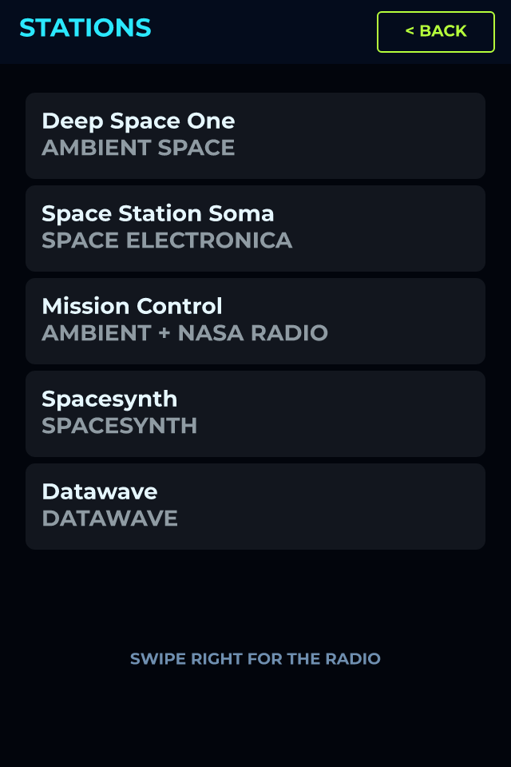
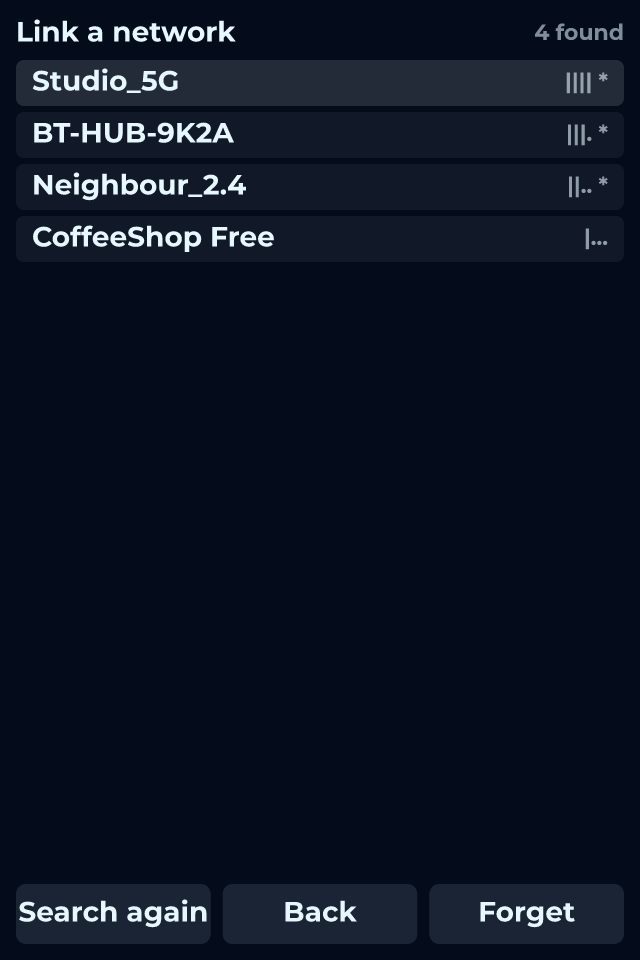
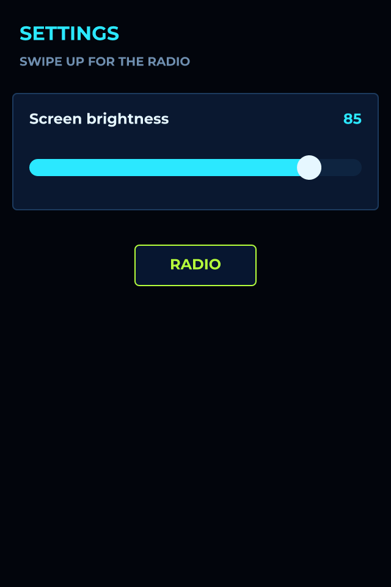

# ORBITAL

*A deep-space internet radio with a HUD volume dial, live bitrate and VU meters, for a 3.5" ESP32-S3 with a proper audio codec.*

A futuristic internet radio for LCDWIKI's 3.5-inch ESP32-S3 display (ES3C35P), and the design to reach for when you want to hear what the board's ES8311 codec can do. It is NEON DECK's radio underneath - the same player bindings, WiFi join and station table - with a portrait layout, a new look, and a real 16-bit audio path.

WHY IT SOUNDS BETTER THAN NEON DECK
NEON DECK plays through the ESP32's own 8-bit DAC, because that is all its board has. This board has an ES8311: a proper codec on I2S, fed a master clock at 256 times the sample rate so one set of dividers holds for every stream. The export sets the codec up over the same I2C bus the touch panel uses, then switches the speaker amplifier on by pulling GPIO 1 low - the board keeps it off until something does. There is PSRAM, so the stream buffer is twice NEON DECK's.

THE VOLUME IS A DIAL, AND THE DIAL IS THE VOLUME
The arc inside the ring is bound both ways to the player: drag it and the level changes; change the level anywhere else and it follows. The number on the core is the same value read back, and the line under it is the stream's own bitrate, live from the decoder.

WHY THE METERS STAND UP
A bar taller than it is wide is drawn vertically by LVGL, so the two meters are simply tall bars, bound to the left and right levels taken off the samples on their way out. The scale marks beside them are in the artwork, not widgets.

WHY THE ARTWORK IS ONE PICTURE
The ring, its tick scale, the orbit, the hex lattice and the plates the text sits on are a single full-screen image, drawn around this layout: the volume dial fits inside the scale ring, the readouts sit on its solid core so no line crosses them, and the ring stops short of the info plate. As widgets it would be dozens of objects; as a picture it is one blit. The panel is drawn a whole frame at a time anyway - its controller wants four-pixel-aligned windows - so a busy background costs nothing extra.

The stations are SomaFM's and Nightride's long-running space and synth streams, all http and 128 kbps MP3. Swap them on the Data tab. Tap the network status at the top left to join WiFi, STATIONS for the list, and swipe down for the brightness.

## Hardware and build

- **Board:** [LCDWIKI 3.5" ESP32-S3 (ES3C35P)](https://lcdwizard.com/boards/lcdwiki-es3c35p)
- **MCU:** ESP32-S3
- **Display:** ST77922 320 x 480, ST77922 (touch half) touch
- **Graphics library:** GFX Library for Arduino
- **LVGL:** 9
- **Exports to:** Arduino (C++)
- **Libraries:** lvgl, ESP8266Audio, GFX Library for Arduino
- **Screens:** 4

## Open it

1. Open the designer: https://app.lcdwizard.com/app (nothing to install, no account needed).
2. **File > Open project file** and choose `design.json` from this folder.
3. Change what you like, then **Export code** for a project that builds for the board.

Or open a copy straight from the gallery: https://lcdwizard.com/p/orbital

## Screens

### Radio

### Stations

### Network

### Settings

## Artwork

The images this design uses, as the original files. They are also inside `design.json`, so the design opens without them.

- [`assets/orbital-bg.png`](assets/orbital-bg.png) - 320 x 480
- [`assets/orbital-wordmark.png`](assets/orbital-wordmark.png) - 220 x 44
- [`assets/orb-play.png`](assets/orb-play.png) - 72 x 72
- [`assets/orb-play-on.png`](assets/orb-play-on.png) - 72 x 72
- [`assets/orb-stop.png`](assets/orb-stop.png) - 72 x 72
- [`assets/orb-stop-on.png`](assets/orb-stop-on.png) - 72 x 72
- [`assets/orb-next.png`](assets/orb-next.png) - 56 x 56
- [`assets/orb-next-on.png`](assets/orb-next-on.png) - 56 x 56
- [`assets/orb-prev.png`](assets/orb-prev.png) - 56 x 56
- [`assets/orb-prev-on.png`](assets/orb-prev-on.png) - 56 x 56
