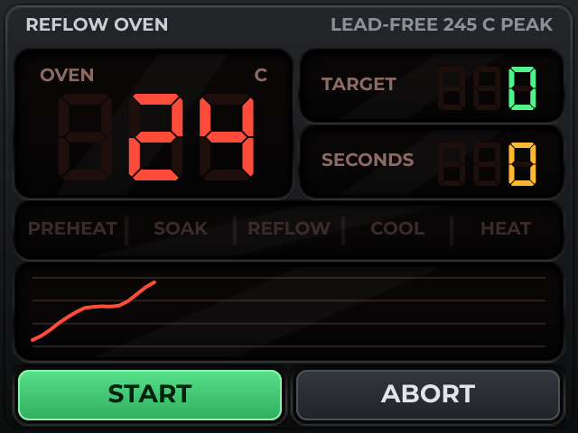

# Reflow Oven Controller

*A lead-free profile, a thermocouple on SPI, and a chart of what the oven actually did.*

The example that has to be Arduino.

A MAX31855 on SPI, a profile clock, and a control loop tight enough that nobody wants it going through a network stack. The profile is the lead-free one everyone starts from: ramp to 150 C over ninety seconds, soak there to three minutes, ramp to 245 C, then off.

The chart is the point of the screen. A reflow that missed its soak is obvious on a curve and invisible in a number, and the chart is also why this cannot be an ESPHome design - ESPHome has no chart widget. The row of names above it is the profile's stages, and each is two labels in one place: the name unlit, and the same name lit, shown only while that is the stage.

Control is bang-bang with a 2 C band. An oven has minutes of thermal lag, so anything cleverer is pretending to a precision the element does not have.

On an STM32F407, which is the board to pick when the loop matters more than the network.

## Hardware and build

- **Board:** [STM32F407 + ILI9341 SPI](https://lcdwizard.com/boards/stm32f407-ili9341)
- **MCU:** STM32F4 (F401 / F407 / F411)
- **Display:** ILI9341 240 x 320, XPT2046 touch
- **Graphics library:** LovyanGFX
- **LVGL:** 9
- **Exports to:** Arduino (C++)
- **Peripherals:** MAX31855 (thermocouple)
- **Libraries:** lvgl, LovyanGFX, Adafruit MAX31855 library
- **Screens:** 1

## Open it

1. Open the designer: https://app.lcdwizard.com/app (nothing to install, no account needed).
2. **File > Open project file** and choose `design.json` from this folder.
3. Change what you like, then **Export code** for a project that builds for the board.

Or open a copy straight from the gallery: https://lcdwizard.com/p/reflow-oven

## Artwork

The images this design uses, as the original files. They are also inside `design.json`, so the design opens without them.

- [`assets/panel-reflow.png`](assets/panel-reflow.png) - 320 x 240
