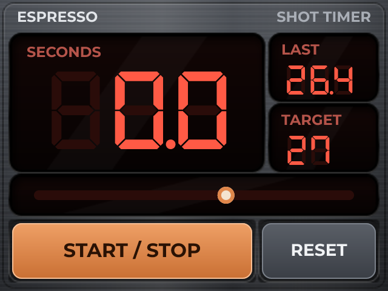

# Espresso Shot Timer

*A big readable number, a target band, and the last shot to compare against.*

No sensors. The board is the whole of it.

A shot is twenty-five to thirty seconds, and what you want is a number you can read from across the bench, a band to land in, and the last one to compare against. The bar fills towards the target and the in-range marker appears when you are within two seconds of it. The target is a marker on that same bar, and dragging it is how you set it.

Built for the M5Stack Core2, which is the right size to sit next to a grinder. Exported as MicroPython so the target and the band are things you can change from the REPL between shots rather than between builds.

## Hardware and build

- **Board:** [M5Stack Core2](https://lcdwizard.com/boards/m5stack-core2)
- **MCU:** ESP32 (WROOM / WROVER)
- **Display:** ILI9342 / ILI9342C 320 x 240, FT6236 / FT6336U touch
- **Graphics library:** LovyanGFX
- **LVGL:** 9
- **Exports to:** MicroPython
- **Libraries:** lvgl, LovyanGFX
- **Screens:** 1

## Open it

1. Open the designer: https://app.lcdwizard.com/app (nothing to install, no account needed).
2. **File > Open project file** and choose `design.json` from this folder.
3. Change what you like, then **Export code** for a project that builds for the board.

Or open a copy straight from the gallery: https://lcdwizard.com/p/shot-timer

## Artwork

The images this design uses, as the original files. They are also inside `design.json`, so the design opens without them.

- [`assets/panel-shot.png`](assets/panel-shot.png) - 320 x 240
