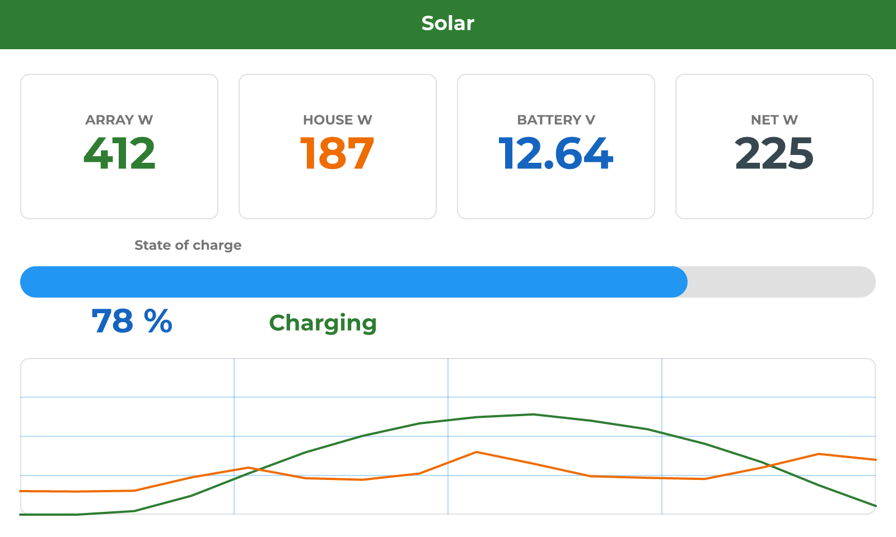

# Solar Dashboard

*Array, house, battery and net power, with a day of history on one chart.*

Seven hundred watts on a shed roof and the four numbers that matter: what the array is making, what the house is drawing, where the battery is, and which way the difference is going.

Two INA219s share one bus - one on the array, one on the load - which is the cheap way to do this and is why their addresses differ. State of charge is a lead-acid rest curve on the battery voltage: it reads pessimistic under load, which is the direction you want to be wrong in.

The chart carries two series on one set of axes, which is the comparison you actually look at - generation against consumption, not either alone.

## Hardware and build

- **Board:** [Sunton ESP32-8048S070 (7" RGB)](https://lcdwizard.com/boards/sunton-8048s070)
- **MCU:** ESP32-S3
- **Display:** ST7262 800 x 480, GT911 touch
- **Graphics library:** GFX Library for Arduino
- **LVGL:** 9
- **Exports to:** Arduino (C++)
- **Peripherals:** INA219 (current)
- **Libraries:** lvgl, GFX Library for Arduino, Adafruit INA219
- **Screens:** 1

## Open it

1. Open the designer: https://app.lcdwizard.com/app (nothing to install, no account needed).
2. **File > Open project file** and choose `design.json` from this folder.
3. Change what you like, then **Export code** for a project that builds for the board.

Or open a copy straight from the gallery: https://lcdwizard.com/p/solar-dashboard
