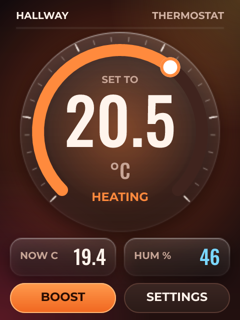
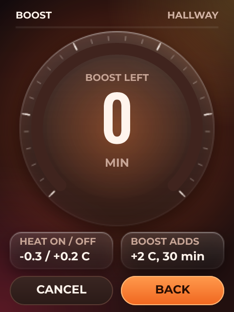

# Heating Thermostat

*A room thermostat with a dial, hysteresis, and a boost that expires by itself.*

A thermostat that behaves like one.

The dial writes a setpoint and the firmware reads it back, so the number on screen is the number the logic uses. Heat comes on 0.3 C below target and off 0.2 C above it - the gap is what stops a relay chattering when the room sits exactly on the setpoint. Boost adds 2 C for half an hour and counts itself down a minute at a time.

A BME280 on the capacitive CYD CN1 connector measures the room.

The settings screen is the same dial showing the boost run down, so the two screens share one backdrop.

Exported with Home Assistant turned on, the setpoint, the temperature and the heat demand all appear as entities - so a schedule can live in Home Assistant while the panel keeps working when the network does not.

## Hardware and build

- **Board:** [ESP32-2432S028C (capacitive CYD)](https://lcdwizard.com/boards/cyd-2432s028c)
- **MCU:** ESP32 (WROOM / WROVER)
- **Display:** ILI9341 320 x 240, CST820 touch
- **Graphics library:** TFT_eSPI
- **LVGL:** 9
- **Exports to:** ESPHome
- **Peripherals:** BME280
- **Libraries:** lvgl, TFT_eSPI, Adafruit BME280 Library
- **Screens:** 2

## Open it

1. Open the designer: https://app.lcdwizard.com/app (nothing to install, no account needed).
2. **File > Open project file** and choose `design.json` from this folder.
3. Change what you like, then **Export code** for a project that builds for the board.

Or open a copy straight from the gallery: https://lcdwizard.com/p/thermostat

## Screens

### Main

### Settings

## Artwork

The images this design uses, as the original files. They are also inside `design.json`, so the design opens without them.

- [`assets/panel-thermo.png`](assets/panel-thermo.png) - 240 x 320
