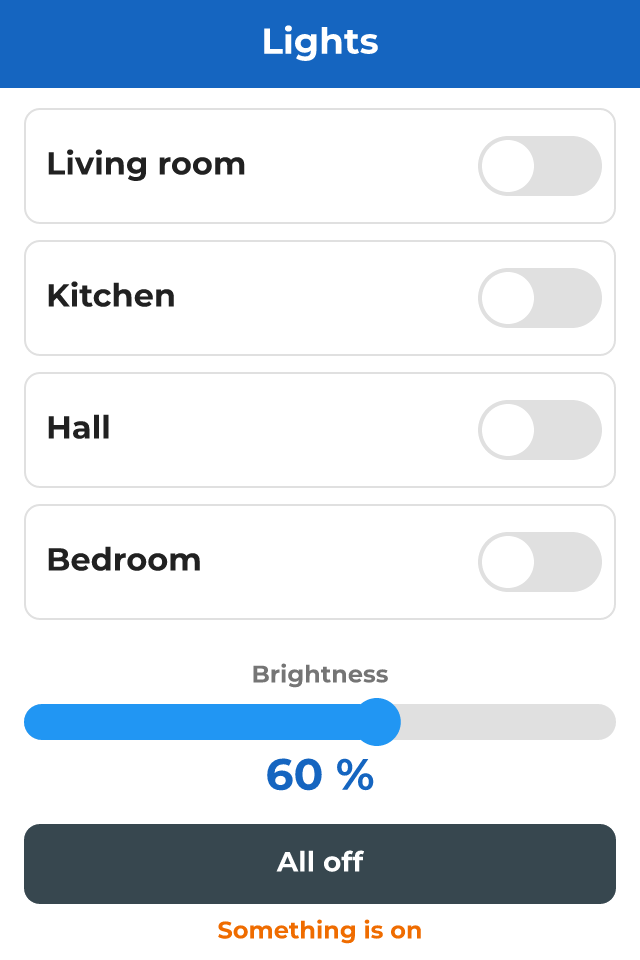

# Lighting Wall Panel

*Four rooms, a dimmer and an all-off, published to Home Assistant as entities.*

Nothing here is wired to the board.

Every switch and the dimmer are bound to variables, and with Home Assistant turned on each of those is published as an entity. The panel drives real lights without the board knowing what a light is - which is the reason to build a wall panel in ESPHome rather than in C.

All off sets every room in one press, and a banner tells you when something is still on, which is the state you actually want to see from the doorway.

The WT32-SC01 is 320 x 480 with capacitive touch, so the rows are big enough to hit without looking.

## Hardware and build

- **Board:** [WT32-SC01](https://lcdwizard.com/boards/wt32-sc01)
- **MCU:** ESP32 (WROOM / WROVER)
- **Display:** ST7796 / ST7796S 320 x 480, FT6236 / FT6336U touch
- **Graphics library:** LovyanGFX
- **LVGL:** 9
- **Exports to:** ESPHome
- **Libraries:** lvgl, LovyanGFX
- **Screens:** 1

## Open it

1. Open the designer: https://app.lcdwizard.com/app (nothing to install, no account needed).
2. **File > Open project file** and choose `design.json` from this folder.
3. Change what you like, then **Export code** for a project that builds for the board.

Or open a copy straight from the gallery: https://lcdwizard.com/p/wall-panel
